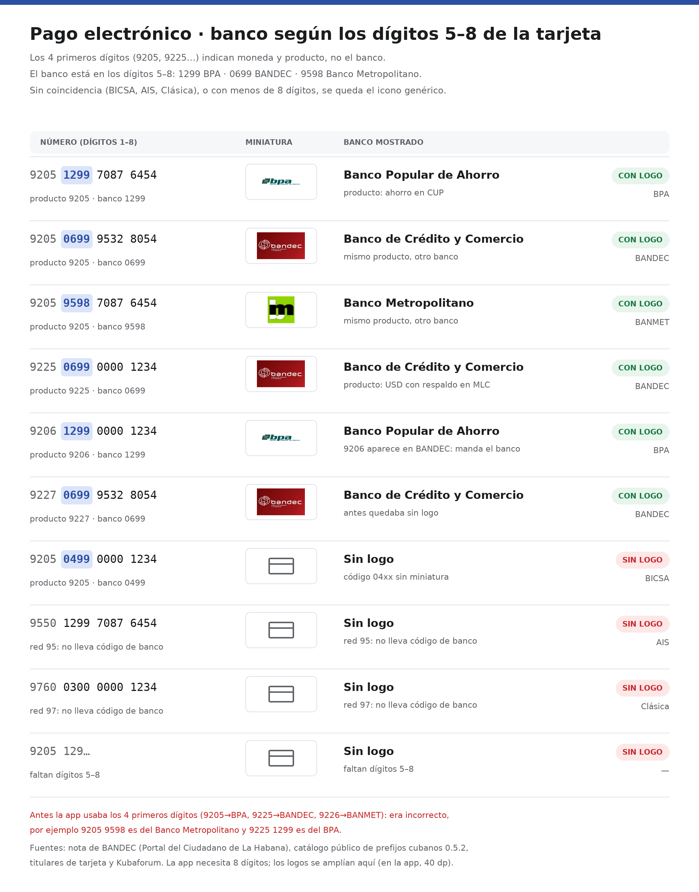

# Logotipos y bancos de las tarjetas cubanas

**Estado (2026-11-01):** el banco se identifica por los **dígitos 5–8** de la tarjeta, no por los 4 primeros. Las
licencias de redistribución de los tres logotipos siguen sin verificarse: antes de publicar, confirmarlas con los
bancos o sustituir las imágenes por recursos autorizados.

## Cómo se lee el número de una tarjeta RED

Las tarjetas de BPA, BANDEC y Banco Metropolitano siguen la estructura de la red RED: 16 dígitos.

| Dígitos | Qué indican | Ejemplo |
|---|---|---|
| 1–2 | Red: `92` RED, `95` AIS, `97` Clásica | `92` |
| 3–4 | Producto y moneda (los 4 primeros dígitos) | `05` ahorro en CUP, `25` USD con respaldo en MLC |
| **5–8** | **Banco emisor** | `1299` BPA, `0699` BANDEC, `9598` Banco Metropolitano |
| 9–15 | Cuenta | — |
| 16 | Dígito de control (Luhn) | — |

Es decir: `9205` dice **qué producto** es (ahorro en CUP) y **no** de qué banco. Una `9205 1299 …` es del BPA, una
`9205 0699 …` es de BANDEC y una `9205 9598 …` es de Banco Metropolitano. El mismo producto lo emiten los tres bancos.

## La regla anterior era incorrecta

Hasta la fecha, la app elegía el logo por los 4 primeros dígitos (`9205` → BPA, `9225` → BANDEC, `9226` → BANMET).
Eso confundía **producto** con **emisor** y producía errores visibles:

- `9205 9598 …` (ahorro en CUP del Banco Metropolitano) mostraba el logo de BPA.
- `9225 1299 …` (MLC del BPA) mostraba el logo de BANDEC.
- `9227 0699 …` (nómina de BANDEC) quedaba sin logo porque `9227` no estaba en la tabla.

Además, la nota de BANDEC describe `9225`, `9226` y `9235` como productos, no como emisores: los titulares han
confirmado tarjetas `9205`/`9206` tanto del BPA como del Banco Metropolitano. Por eso ninguna tabla basada solo en los
4 primeros dígitos puede acertar el banco.

## Códigos de banco verificados

| Dígitos 5–8 | Banco | Miniatura | Fuentes |
|---|---|---|---|
| `0699` | Banco de Crédito y Comercio (BANDEC) | `bandec_miniatura.png` | Catálogo público 0.5.2 · Kubaforum · titulares |
| `1299` | Banco Popular de Ahorro (BPA) | `bpa_miniatura.png` | Catálogo público 0.5.2 · Kubaforum · titulares |
| `9598` | Banco Metropolitano (BANMET) | `banmet_miniatura.png` | Catálogo público 0.5.2 · Kubaforum · titulares |
| `04xx` | Banco Internacional de Comercio (BICSA) | sin miniatura en la app | Catálogo público 0.5.2 (solo se conocen los dígitos 5–6) |

Las redes **AIS** (`9550`, `9560`) y **Clásica** (`9760`) no llevan código de banco en los dígitos 5–8: la primera la
emite American International Services y la segunda Financiera CIMEX, así que se quedan con el icono genérico.

### Regla implementada

`PagoElectronicoLogic.kt`:

- `codigoBanco(numero)` toma los dígitos 5–8 y devuelve `null` si todavía hay menos de 8 dígitos o si la tarjeta no es
  de la red RED (`92`). Así la vista previa aparece cuando el número ya permite decidir el banco, no antes.
- `bancoPorTarjeta(numero)` compara ese código con `BancoCubano.codigo` (`1299`, `0699`, `9598`). Sin coincidencia,
  `miniaturaBanco` no se pinta y queda el icono genérico de tarjeta.
- No se valida Luhn, ni la titularidad, ni la moneda, ni la capacidad de recibir transferencias.

En la hoja de edición, la vista previa escribe el código que decidió la miniatura: **«Código de banco 1299 ·
orientativo»**. En iOS la misma regla vive en `bancoCubano(_:)` dentro de `SettingsView.swift`.

## Presentación

- El logo se pinta con `Image(painterResource(miniaturaBanco(banco)), ContentScale.Fit)` dentro de un cuadro de
  `ShalevSize.miniatura` (40 dp), sin fondo ni borde propios. Los PNG no se modificaron.
- BANDEC (rojo a sangre) y BANMET (fondo verde) llenan casi todo el cuadro; BPA es transparente y muy alargado, así
  que se ve más pequeño. Si se quiere igualar el peso visual, el cambio va en el recurso, no en la tabla de bancos.
- La lista de «Tarjetas y cuentas» muestra la sigla del banco como subtítulo cuando el código coincide.

## Selección de miniatura por código de banco

| Número | Dígitos 5–8 | Miniatura | Banco mostrado |
|---|---|---|---|
| `9205 1299 7087 6454` | `1299` | `bpa_miniatura.png` | Banco Popular de Ahorro |
| `9205 0699 9532 8054` | `0699` | `bandec_miniatura.png` | Banco de Crédito y Comercio |
| `9205 9598 7087 6454` | `9598` | `banmet_miniatura.png` | Banco Metropolitano |
| `9225 0699 0000 1234` | `0699` | `bandec_miniatura.png` | Banco de Crédito y Comercio |
| `9206 1299 0000 1234` | `1299` | `bpa_miniatura.png` | Banco Popular de Ahorro |
| `9227 0699 9532 8054` | `0699` | `bandec_miniatura.png` | Banco de Crédito y Comercio |
| `9205 0499 0000 1234` | `0499` | — | Sin logo (BICSA) |
| `9550 1299 7087 6454` | — | — | Sin logo (AIS, red 95) |
| `9760 0300 0000 1234` | — | — | Sin logo (Clásica, red 97) |
| `9205 129…` (7 dígitos) | — | — | Sin logo (faltan dígitos) |

## Verificación de las fuentes (2026-11-01)

1. **[Portal del Ciudadano de La Habana — «Cómo identificar tarjetas bancarias en Cuba por sus dígitos»](https://www.lahabana.gob.cu/post_detalles/es/29956/como-identificar-tarjetas-bancarias-en-cuba-por-sus-digitos)**
   (7/8/2026, reproduce una nota de BANDEC): los **primeros cuatro dígitos** informan «el tipo de moneda y el propósito
   de la cuenta»; `9205` es ahorro, `9225`/`9235`/`9240` son USD con respaldo en MLC, `9226` es TCP y productores
   agropecuarios. No dice en ningún momento que esos dígitos indiquen el banco.
2. **[qvapay/cuban_cards_prefixes, catálogo público 0.5.2](https://github.com/qvapay/cuban_cards_prefixes)** (21/10/2026):
   estructura RED con red en 1–2, producto en 3–4 y **emisor en 5–8**; `issuers` con `0699` BANDEC, `1299` BPA,
   `9598` Banco Metropolitano y `04xx` BICSA. Los patrones de `validators.json` aceptan cualquier producto RED con
   cualquiera de esos códigos, que es exactamente lo que refleja la app.
3. **Titulares de tarjeta** (issues #12, #18 y #23 del mismo catálogo): confirman `1299` en tarjetas `9205` y `9206`
   del BPA y `9598` en tarjetas `9205`/`9206` del Banco Metropolitano, además de `0699` en BANDEC.
4. **[Kubaforum — «Überweisung mit Sparkasse auf BPA-Konto»](https://www.kubaforum.eu/artikel/ueberweisung-mit-sparkasse-auf-bpa-konto.35643/)**:
   da los dígitos 5–8 de BANDEC (`0699`), BPA (`1299`) y Banco Metropolitano (`9598`).
5. **Transfermóvil** identifica el banco con los dígitos 5–6 (`06` BANDEC, `12` BPA, `95` Metropolitano), que son los
   dos primeros de los cuatro usados por la app. La app exige los cuatro dígitos 5–8 completos para ser más estricta,
   y por eso la vista previa aparece cuando ya hay 8 dígitos.

Las fuentes comerciales que asignan banco por los 4 primeros dígitos (por ejemplo `9226` → Banco Metropolitano) son
aproximaciones: la nota oficial de BANDEC y el catálogo con código de banco las contradicen. Se conservan aquí solo
como referencia de por qué la regla anterior parecía plausible.

## Archivos incluidos y licencias

| Recurso | Banco | Fuente consultada para el logotipo |
|---|---|---|
| `app/src/main/res/drawable-nodpi/bpa_miniatura.png` | Banco Popular de Ahorro (BPA) | [Artículo de Wikipedia sobre BPA](https://es.wikipedia.org/wiki/Banco_Popular_de_Ahorro), con una imagen servida desde Wikimedia Commons. No se verificó la licencia específica del archivo descargado. |
| `app/src/main/res/drawable-nodpi/bandec_miniatura.png` | Banco de Crédito y Comercio (BANDEC) | [Artículo de EcuRed sobre BANDEC](https://www.ecured.cu/Banco_de_Cr%C3%A9dito_y_Comercio). EcuRed no se tomó como prueba de licencia de redistribución. |
| `app/src/main/res/drawable-nodpi/banmet_miniatura.png` | Banco Metropolitano (BANMET) | [Ficha de Banco Metropolitano en el portal de La Habana](https://www.lahabana.gob.cu/entity_detalles/es/20/banco-metropolitano-s-a). La ficha no acredita por sí sola permiso para reutilizar el logotipo. |

Que una imagen sea visible o descargable desde una página pública **no significa que sea de dominio público**. Los
nombres, emblemas y marcas siguen perteneciendo a sus titulares; no se presume autorización comercial. El recorte y
tratamiento de los recursos para la interfaz no cambia esa situación. Conservar esta advertencia hasta que se
verifiquen las licencias y, si corresponde, añadir la atribución que exijan.

## Comprobación de los recursos (2026-11-01)

`bpa_miniatura.png` y `banmet_miniatura.png` estaban intercambiados: el primero contenía el monograma «bm» de BANMET y
el segundo el logotipo «bpa». Se intercambiaron los contenidos; `bandec_miniatura.png` ya era correcto. La nota
anterior de esta misma fecha afirmaba que la correspondencia estaba corregida, pero solo se habían renombrado los
archivos. `PagoLogicTest` comprueba qué recurso usa cada banco.
